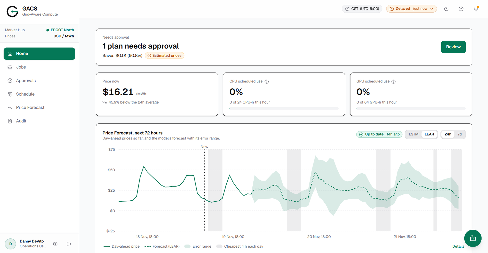
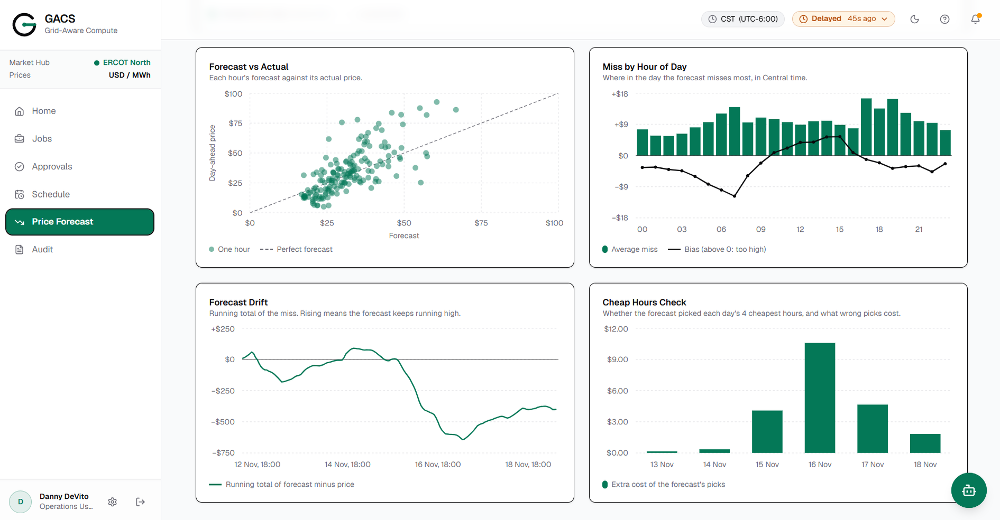
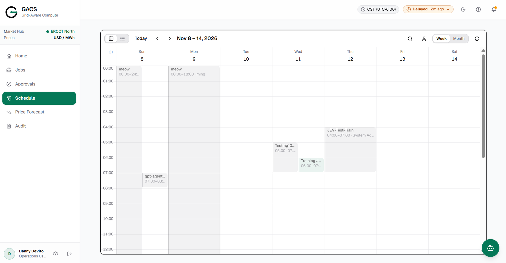
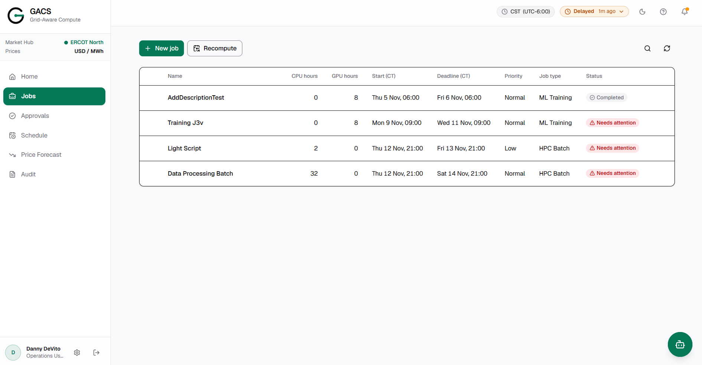
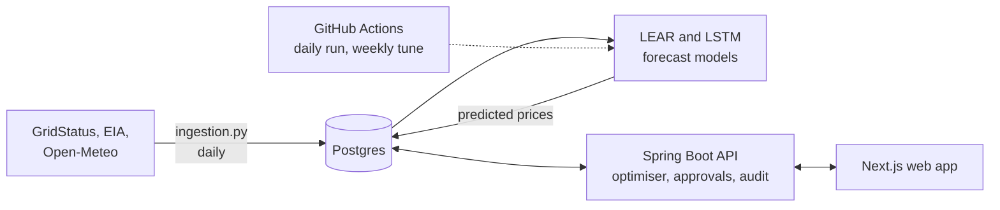

# Grid-Aware Compute Scheduler (GACS)

GACS moves flexible compute workloads, such as AI training and batch jobs, to the hours when
electricity on the ERCOT grid is cheapest. It forecasts hourly day-ahead prices for the
`LZ_NORTH` load zone, then plans each job inside its deadline and capacity limits. People
review and approve every plan before it takes effect.

- **Price forecasts:** LEAR and LSTM models predict each hour's price 48 and 72 hours ahead.
- **Scheduling:** an optimiser picks the cheapest feasible hours for each job.
- **Constraints in plain text:** a job's rules can be written in natural language and parsed
  into constraints.
- **Approvals and audit:** plans, not jobs, are approved. By default the person who submitted a
  plan cannot approve it, unless they are an admin. Approvals, rejections, revocations and other
  plan decisions go to an audit log.
- **Backtesting:** the optimiser is replayed over historical prices and compared with a fixed
  schedule. The target is a 15–25% cut in energy cost for flexible load.

## Screenshots

<table>
  <tr>
    <td align="center"><b>Home</b><br></td>
    <td align="center"><b>Price Forecast</b><br></td>
  </tr>
  <tr>
    <td align="center"><b>Schedule</b><br></td>
    <td align="center"><b>Jobs</b><br></td>
  </tr>
</table>

## How it fits together



The daily GitHub Actions workflow (`.github/workflows/daily-pipeline.yml`) ingests new data and
writes predictions. The weekly workflow (`weekly-tune.yml`) retrains the models and promotes a
new one only if it scores better than the active one. `render.yaml` defines an equivalent
Render cron job for the daily run.

## Repository layout

| Folder or file | What it holds |
|---|---|
| `backend/` | Spring Boot API: authentication, jobs, approvals, audit, prices, optimiser |
| `frontend/` | Next.js web app. See [frontend/README.md](frontend/README.md) and [frontend/STYLE.md](frontend/STYLE.md) |
| `data_scripts/` | Python data ingestion, feature store, daily predictions and the weekly model tune |
| `model/` | LEAR and LSTM model code, LSTM training and the modelling plan ([model/model.md](model/model.md)) |
| `backtest/` | Backtest of the optimiser against a fixed schedule. See [backtest/README.md](backtest/README.md) |
| `docs/` | API contract, deployment runbook, design plans and policies |
| `data/` | Local data files. Gitignored |
| `render.yaml` | Render Blueprint for the daily cron job |
| `.github/workflows/` | CI, CD, the daily pipeline and the weekly model tune |

## Tech stack

| Layer | Stack |
|---|---|
| Backend | Spring Boot (Java 25), Spring Security with JWT and refresh tokens, email OTP, PostgreSQL |
| Frontend | Next.js, TypeScript, Vitest |
| Forecasting | Python: LEAR, PyTorch LSTM |
| Ops | GitHub Actions (CI, CD, daily pipeline, weekly retuning), Render |

## Quick start

### Prerequisites

- Java 25 (the Maven wrapper is included)
- Node.js 24 and npm
- Python 3.13 and pip
- A Postgres database (the team uses Supabase). Backend tests use a built-in in-memory database (H2), so they need no setup.

These are the versions CI uses.

### 1. Environment

```bash
cp .env.example .env
```

Fill in the values you need. The backend and the Python scripts read this one root `.env`.
Keep it private and never commit it. See [Environment variables](#environment-variables).

### 2. Backend

```bash
cd backend
./mvnw spring-boot:run
```

The API runs on `http://localhost:8080`. Swagger UI is at `/swagger-ui.html`. Email sending
needs a one-time Gmail setup: see [docs/gmail-api-setup.md](docs/gmail-api-setup.md).

### 3. Frontend

```bash
cd frontend
npm ci
npm run dev
```

The app runs on `http://localhost:3000` and calls the backend on `http://localhost:8080` by
default. To use a different backend, or to turn on the in-app assistant, copy
`frontend/.env.example` to `frontend/.env.local` and fill it in. Next.js reads `.env.local` from
`frontend/` only, not the root `.env`.

### 4. Data and forecasts

```bash
pip install -r data_scripts/requirements.txt
cd data_scripts
python ingestion.py        # pull new weather, EIA and day-ahead price data
python predict_lstm.py     # write LSTM price predictions
python predict_lear.py     # write LEAR price predictions
```

The daily workflow runs the scripts from `data_scripts/`, so do the same. The scripts write to
the database in `DATABASE_URL`, which is the same database the backend reads. The backend does not
generate forecasts itself, so run the predictions again after new data arrives, or let the daily
workflow do it. `data_scripts/update.py` is the weekly model tune. `data_scripts/predictions.py`
is a local testing tool.

## Environment variables

| Variable | Used by | Purpose |
|---|---|---|
| `DATABASE_URL` | backend, data scripts | Database connection |
| `GRIDSTATUS_API_KEY` | data scripts | [GridStatus.io](https://www.gridstatus.io) day-ahead prices |
| `EIA_API_KEY` | data scripts | [EIA](https://www.eia.gov/opendata/) generation and demand data |
| `PORT` | backend | Server port |
| `JWT_SECRET_KEY`, `JWT_*_EXPIRATION_MS` | backend | Token signing and lifetimes |
| `COOKIE_SECURE`, `CORS_ALLOWED_ORIGINS` | backend | Cookie and cross-origin settings |
| `GMAIL_*` | backend | Sender account for verification, recovery and alert emails |
| `TYPESAFE_API_KEY` | backend | Optional. Natural-language constraint parsing. Without it, a rule-based parser runs |
| `NEXT_PUBLIC_API_BASE_URL` | frontend | Backend URL. Defaults to `http://localhost:8080` in development. Required in production |
| `ANTHROPIC_API_KEY`, `JWT_SECRET_KEY` | frontend | Optional. The in-app help assistant. `JWT_SECRET_KEY` must match the backend's |

[.env.example](.env.example) and [frontend/.env.example](frontend/.env.example) explain each
variable. `NEXT_PUBLIC_API_BASE_URL` is not in either file, so add it to `frontend/.env.local`
when you need it.

## Tests

```bash
(cd backend && ./mvnw test)                # backend
(cd frontend && npm test)                  # frontend
(cd frontend && npx tsc --noEmit)          # frontend type check
(cd data_scripts && pip install -r requirements-dev.txt && pytest)   # data scripts
```

Run each line from the repository root.

CI runs the backend, frontend and data-script suites on every pull request.

## Deployment

Merging into `main` builds the app and deploys the backend to Render and the frontend to
Vercel with no manual step. See the [deployment setup](docs/deployment-setup.md) and the
[runbook with rollback steps](docs/deployment-runbook.md).

## Documentation

| Document | Topic |
|---|---|
| [Product requirements](<Product Requirements Document_ Grid Aware Compute Scheduler (GACS).md>) | Goals and scope |
| [docs/api-contract.md](docs/api-contract.md) | REST API contract |
| [docs/deployment-setup.md](docs/deployment-setup.md), [docs/deployment-runbook.md](docs/deployment-runbook.md) | Deployment and rollback |
| [docs/gmail-api-setup.md](docs/gmail-api-setup.md) | Email delivery |
| [docs/password-recovery.md](docs/password-recovery.md), [docs/token-expiry-and-secure-storage-policy.md](docs/token-expiry-and-secure-storage-policy.md) | Account security |
| [docs/optimiser-rebuild-plan.md](docs/optimiser-rebuild-plan.md), [docs/constraint-parser-plan.md](docs/constraint-parser-plan.md), [docs/schedule-explanation-design.md](docs/schedule-explanation-design.md) | Optimiser design |
| [docs/backtest-plan.md](docs/backtest-plan.md), [docs/model_comparison.md](docs/model_comparison.md) | Backtest and model results |
| [docs/branch-workflow.md](docs/branch-workflow.md) | Branch rules |

## Contributing

1. Branch off `staging`.
2. Open a pull request into `staging`.
3. Changes reach `main` only through a pull request from `staging` with at least one approval.
   Direct pushes to `main` are blocked.