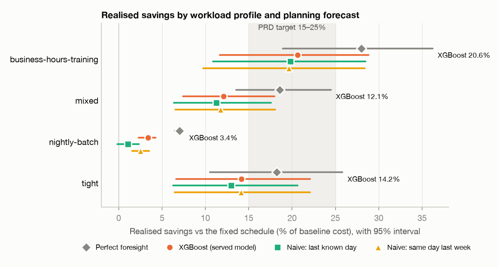
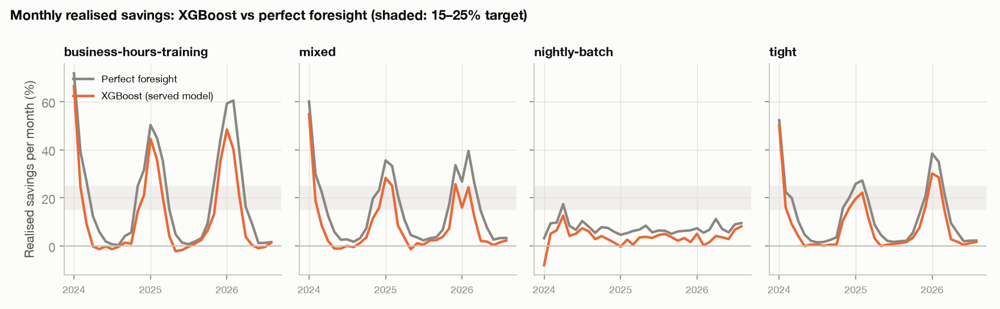
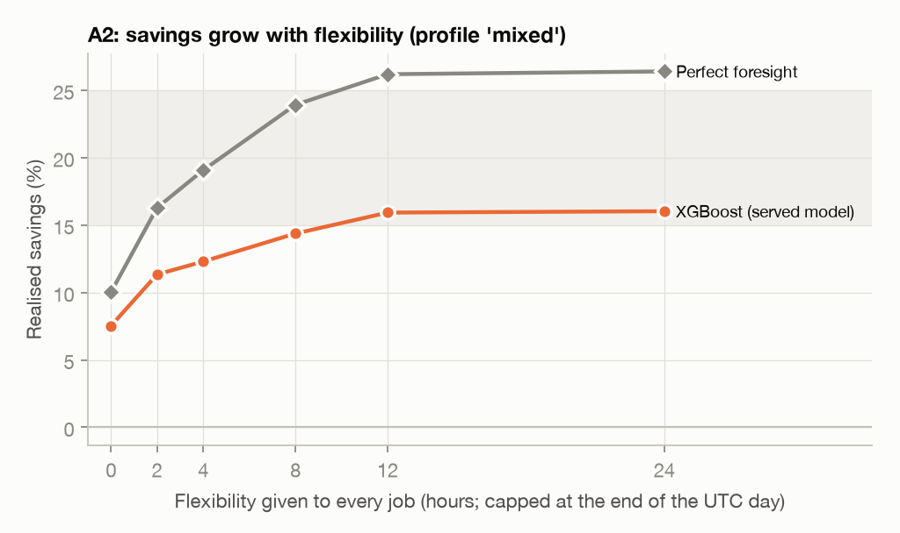

# Backtest report: grid-aware scheduling vs a fixed schedule (2026-11-01)

Generated by `backtest/run_report.sh` (ticket 3 of [docs/backtest-plan.md](../backtest-plan.md)). Every number below comes from the run files listed under [Method](#2-method).

## 1. Headline

Planning on the **served XGBoost 48-hour forecast**, the optimiser cut energy cost against the fixed schedule by **12.1%** for the `mixed` workload, from 3.4% to 20.6% across the realistic profiles. With perfect price foresight the same jobs would have saved 7.0%–28.0%. Period: 2024-01-03 to 2026-08-29 (970 days), ERCOT LZ_NORTH day-ahead prices.

| Profile | XGBoost realised | 95% interval | Perfect foresight | Naive last known | Naive last week | Share of possible savings captured | Overlaps 15–25% |
|---|---:|---:|---:|---:|---:|---:|---|
| business-hours-training | 20.6% | [11.6, 28.8] | 28.0% | 19.8% | 19.6% | 74% | yes |
| mixed | 12.1% | [7.4, 18.0] | 18.6% | 11.3% | 11.8% | 65% | yes |
| nightly-batch | 3.4% | [2.3, 4.3] | 7.0% | 1.1% | 2.5% | 48% | no |
| tight | 14.2% | [6.6, 22.1] | 18.2% | 13.0% | 14.1% | 78% | yes (lower bound) |

Realised = plan made on the forecast, paid at actual prices. Intervals: 7-day moving-block bootstrap, 2,000 draws. `tight` (0–2 h flexibility) was meant as a lower bound and is not judged against the target. It isn't a strict one: deadline slack still lets jobs reshape their work (section 6, A2).

**Key findings**

- **Seasonal.** For `mixed`, savings are 28.1% in winter and 0.8% in summer. In winter the median price falls through the afternoon ($31/MWh at 13:00 UTC to $14 by evening), so delaying daytime jobs pays. In summer they already start in the cheapest hours ($16–18 at 13–15 UTC) and prices only rise until midnight UTC ($40), past which jobs can't move (section 7).
- **The forecast captures about 65% of what was possible** (`mixed`). XGBoost beats the naive forecasts, but only by about a point (A5).
- **About 22% of days cost slightly more** than the fixed schedule: days with little to gain where the forecast saw a spread that wasn't there (A7).
- **The app's projected savings are off** by -9.6 to +2.5 points on the realistic profiles (A6).
- **The optimiser itself is sound:** 0 rule violations, 100% of jobs scheduled by their deadline, 99.98% of plans proven optimal.

**Assumption verdicts** (details in section 6):

| # | Assumption | Verdict |
|---|---|---|
| A1 | Savings of 15–25% are achievable | **Partly met** |
| A2 | Flexibility is what drives savings | **Partly met** |
| A3 | Results don't hinge on the kWh factors (0.05 / 0.40) | **Pass** |
| A4 | Capacity doesn't distort the result | **Pass (explained)** |
| A5 | The forecast is good enough to act on | **Pass** |
| A6 | The app's projected savings are honest | **Fail** |
| A7 | Negative savings are rare | **Fail (investigated)** |
| A8 | The heuristic is close to optimal | **Pass** |
| A9 | Price spikes don't dominate | **Pass** |

## 2. Method

- **Workloads:** four synthetic, versioned profiles (`backend/src/test/resources/backtest/profiles/`), jobs drawn with fixed seeds per day. Every accepted day's fixed schedule fits the facility (decision D2).
- **Facility:** 256 CPU-hours and 64 GPU-hours per hour; 0.05 kWh per CPU-hour and 0.4 kWh per GPU-hour.
- **Planning:** one plan per UTC day per price source, by the production allocation code (exact solver with a 30 s budget, else the deterministic heuristic). Every plan is settled at actual prices and checked against the contract rules.
- **Forecasts:** walk-forward, out of sample: the y0 (48 h ahead) XGBoost model retrained on five expanding windows by `model/evaluate.py`, plus two naive forecasts. Each day is planned with the forecast made two days before it, which is what the app has. The training files were rebuilt in the current feature layout by `backtest/build_features.py`; scoring the saved y0 model on them reproduces the held-out error per hour recorded in `data_scripts/predictions.py` exactly.
- **Savings rule:** days with an unscheduled job are left out of savings figures (none were).

Runs (all under `backtest/output/report/`, not committed):

| Run | Commit | Solver | Profiles | Day rows | Violations | Proven optimal | actual_prices.csv | forecast_xgb.csv |
|---|---|---|---:|---:|---:|---:|---:|---|
| a2-flexibility | d84d4af+changes | repeatable | 6 | 11,640 | 0 | 99.45% | 18bf82754a91 | a12743fd0abb |
| a3-cpu-kwh-0.5x | d84d4af+changes | repeatable | 4 | 7,760 | 0 | 99.97% | 18bf82754a91 | a12743fd0abb |
| a3-cpu-kwh-2x | d84d4af+changes | repeatable | 4 | 7,760 | 0 | 99.97% | 18bf82754a91 | a12743fd0abb |
| a3-gpu-kwh-0.5x | d84d4af+changes | repeatable | 4 | 7,760 | 0 | 99.97% | 18bf82754a91 | a12743fd0abb |
| a3-gpu-kwh-2x | d84d4af+changes | repeatable | 4 | 7,760 | 0 | 99.96% | 18bf82754a91 | a12743fd0abb |
| a4-capacity-0.5x | d84d4af+changes | repeatable | 4 | 7,760 | 0 | 99.95% | 18bf82754a91 | a12743fd0abb |
| a4-capacity-2x | d84d4af+changes | repeatable | 4 | 7,760 | 0 | 100.00% | 18bf82754a91 | a12743fd0abb |
| a8-heuristic | d84d4af+changes | heuristic | 4 | 7,760 | 0 | 0.00% | 18bf82754a91 | a12743fd0abb |
| main | d84d4af+changes | repeatable | 4 | 15,520 | 0 | 99.98% | 18bf82754a91 | a12743fd0abb |

Rerun everything: `backtest/run_report.sh` from the repo root (needs `model/train.csv` and `model/val.csv`). Reproduce one run exactly: `mvn test -Dtest=BacktestRun -Dbacktest.run=true -Dbacktest.reproduce=../backtest/output/report/<run>/manifest.json` from `backend/`.

## 3. Savings

### Daily distribution (XGBoost)

| Profile | Mean daily | Median daily | Std dev | 10th pct | 90th pct | Negative days |
|---|---:|---:|---:|---:|---:|---:|
| business-hours-training | 9.6% | 1.8% | 68.3 | -3.2% | 44.7% | 19.9% |
| mixed | 7.5% | 2.6% | 17.6 | -3.6% | 29.5% | 22.2% |
| nightly-batch | 4.0% | 3.2% | 11.3 | -4.0% | 13.1% | 24.8% |
| tight | 6.9% | 2.1% | 14.4 | -2.4% | 24.1% | 22.6% |

The headline uses the ratio of totals (money saved / baseline money). Daily percentages swing much more because some days have a tiny baseline cost.

### By month and season

| Season | business-hours-training | mixed | nightly-batch | tight |
|---|---:|---:|---:|---:|
| Winter | 45.7% | 28.1% | 1.8% | 31.1% |
| Spring | 5.8% | 3.7% | 3.8% | 5.1% |
| Summer | -0.3% | 0.8% | 5.3% | 0.8% |
| Autumn | 6.9% | 4.9% | 3.1% | 4.3% |

### By price volatility

| Days by intraday price std dev | Std dev range ($/MWh) | business-hours-training | mixed | nightly-batch | tight |
|---|---:|---:|---:|---:|---:|
| Calmest 25% | 3–9 | 12.3% | 9.3% | 3.6% | 6.1% |
| 2nd | 9–12 | 11.8% | 8.3% | 3.0% | 6.7% |
| 3rd | 13–19 | 15.2% | 9.7% | 3.5% | 8.2% |
| Most volatile 25% | 19–640 | 32.6% | 17.2% | 3.5% | 24.6% |

### Worst days (`mixed`, XGBoost)

| Date | Baseline | Realised | Saved | Perfect foresight saved | Forecast MAE, hours used ($/MWh) |
|---:|---:|---:|---:|---:|---:|
| 2026-04-27 | $1.88 | $2.99 | $-1.11 | $0.17 | 11 |
| 2025-03-25 | $1.47 | $2.41 | $-0.94 | $0.05 | 6 |
| 2024-06-25 | $1.41 | $2.12 | $-0.72 | $0.01 | 11 |
| 2026-01-24 | $6.65 | $7.24 | $-0.59 | $0.00 | 97 |
| 2025-12-04 | $1.53 | $2.09 | $-0.57 | $0.00 | 18 |
| 2026-04-03 | $1.82 | $2.36 | $-0.53 | $0.06 | 5 |
| 2024-07-16 | $1.56 | $2.07 | $-0.52 | $0.00 | 6 |
| 2025-02-08 | $0.49 | $0.91 | $-0.43 | $0.11 | 28 |

### Negative-savings days (A7 investigation)

| Profile | Days with negative savings | Money lost on those days | Saved on the other days | Forecast MAE on those days ($/MWh, hours used) | on the other days |
|---|---:|---:|---:|---:|---:|
| business-hours-training | 19.9% | $23.65 | $373.78 | 9.2 | 10.2 |
| mixed | 22.2% | $18.50 | $205.80 | 9.9 | 10.7 |
| nightly-batch | 24.8% | $12.57 | $43.78 | 11.9 | 7.8 |
| tight | 22.6% | $13.40 | $239.89 | 12.3 | 10.8 |

Negative days are mostly days with little to gain. On them, perfect foresight could only have saved a few percent, yet the forecast still saw a price difference worth moving jobs for, and it wasn't there:

| Profile | Possible savings on negative days (perfect foresight) | on other days | Savings XGBoost expected on negative days |
|---|---:|---:|---:|
| business-hours-training | 3.8% | 32.7% | 10.7% |
| mixed | 4.6% | 21.6% | 8.7% |
| nightly-batch | 2.0% | 8.9% | 6.3% |
| tight | 4.1% | 21.5% | 7.0% |

Forecast error is not larger on these days (table above); the difference is that there is no real price spread to capture, so any error turns into a loss. The losses are small next to the savings on other days. Planning on actual prices never loses money (0 negative days for perfect foresight) and no rule was violated, so these are forecast misses, not solver faults.

## 4. Forecast

Accuracy of the walk-forward forecasts over every scored hour ($/MWh against the actual price):

| Forecast | MAE | RMSE | Bias | Hours |
|---|---:|---:|---:|---:|
| XGBoost (served model) | 16.86 | 58.49 | +2.99 | 23,280 |
| Naive: last known day | 18.25 | 79.30 | -0.08 | 23,280 |
| Naive: same day last week | 18.86 | 80.39 | -0.16 | 23,280 |

Savings when planning on each forecast, against perfect foresight (realised savings difference in points of baseline cost, with a paired 95% block-bootstrap interval):

| Profile | XGBoost − naive: last known day | XGBoost − naive: same day last week | Gap to perfect foresight |
|---|---:|---:|---:|
| business-hours-training | +0.8 pts [-0.8, +2.5] | +1.0 pts [-0.3, +2.4] | 7.4 pts |
| mixed | +0.8 pts [-0.2, +2.0] | +0.3 pts [-0.6, +1.4] | 6.5 pts |
| nightly-batch | +2.3 pts [+1.1, +4.0] | +0.9 pts [-0.0, +2.1] | 3.6 pts |
| tight | +1.2 pts [-0.2, +3.1] | +0.1 pts [-0.4, +0.6] | 4.1 pts |

Lost savings vs forecast error (`mixed`, XGBoost): days grouped by the forecast's error over the hours the plan used.

| Days | MAE range ($/MWh) | Realised | Perfect foresight | Lost to forecast error |
|---|---:|---:|---:|---:|
| Smallest error 25% | 0.6–4.1 | 4.5% | 7.6% | $10.86 |
| 2nd | 4.1–6.8 | 4.5% | 9.9% | $18.63 |
| 3rd | 6.8–11.5 | 9.3% | 16.4% | $23.23 |
| Largest error 25% | 11.5–572.3 | 24.1% | 33.4% | $47.70 |

### Projected vs realised (A6)

| Profile | Projected (what the app shows) | Realised | Gap (projected − realised) | Mean daily gap | Days projected > realised |
|---|---:|---:|---:|---:|---:|
| business-hours-training | 11.0% | 20.6% | -9.6 pts | -0.6 pts | 36% |
| mixed | 8.8% | 12.1% | -3.3 pts | +0.0 pts | 49% |
| nightly-batch | 5.9% | 3.4% | +2.5 pts | +1.8 pts | 58% |
| tight | 6.8% | 14.2% | -7.4 pts | -0.9 pts | 50% |

## 5. Guardrails

| Profile | Jobs | Scheduled | Deadline adherence | Rule violations | Proven optimal | Energy, baseline = plan |
|---|---:|---:|---:|---:|---:|---|
| business-hours-training | 5,822 | 100.0% | 100.0% | 0 | 100.00% | yes |
| mixed | 7,275 | 100.0% | 100.0% | 0 | 99.90% | yes |
| nightly-batch | 5,460 | 100.0% | 100.0% | 0 | 100.00% | yes |
| tight | 7,271 | 100.0% | 100.0% | 0 | 100.00% | yes |

Solve time per plan (all profiles and sources, 15,520 plans): median 6 ms, 95th percentile 49 ms, max 2.3 s. Not repeatable, so kept out of the hashed results.

## 6. Assumptions

| # | Assumption | Result | Verdict |
|---|---|---|---|
| A1 | Savings of 15–25% are achievable | XGBoost-planned savings interval overlaps 15–25% for 2 of 3 realistic profiles (business-hours-training, mixed). | **Partly met** |
| A2 | Flexibility is what drives savings | Perfect-foresight savings go from 10.0% at 0 h to 26.4% at 24 h; XGBoost from 7.5% to 16.0%. Rising throughout: yes; about 0 at 0 h: no (deadline slack still lets jobs reshape their work, section 6). | **Partly met** |
| A3 | Results don't hinge on the kWh factors (0.05 / 0.40) | Halving or doubling either factor moves XGBoost savings by at most 1.81 points (limit ±2). | **Pass** |
| A4 | Capacity doesn't distort the result | See the capacity table: 0 rule violations across the three capacities. Savings move with how many jobs fit and how much room they have, as expected. | **Pass (explained)** |
| A5 | The forecast is good enough to act on | XGBoost saves +0.1 to +2.3 points more than the naive forecasts, but the 95% interval is above 0 in only 1 of 8 comparisons, so the edge is small. It leaves 3.6–7.4 points of the possible savings on the table (section 4). | **Pass** |
| A6 | The app's projected savings are honest | Projected minus realised savings over the period ranges from -9.6 to +2.5 points: the app under-promises on daytime workloads and over-promises on the night batch (limit: no more than 2 points of over-promise on a realistic profile). Planning on the naive forecasts would over-promise by +4.8 to +10.9 points on the realistic profiles. | **Fail** |
| A7 | Negative savings are rare | Up to 25% of days on a realistic profile cost more than the fixed schedule (investigate above 5%); see the investigation under Savings. | **Fail (investigated)** |
| A8 | The heuristic is close to optimal | On 7,737 proven-optimal plans the heuristic alone costs a median 0.000% more than the exact plan (limit 1%), and is never meaningfully cheaper (differences below 0.0001% are rounding). Its worst single day is 18.1% more expensive, which is why production also runs the exact solver. | **Pass** |
| A9 | Price spikes don't dominate | The top 1% of hours (above $154/MWh) fall on 80 days. Those days give up to 47% of a realistic profile's savings (flag above 50%). | **Pass** |

A failed assumption is a finding, not a bug. Thresholds: A3 and A8 are the plan's. A6 (≤ 2 points of over-promise), A7 (investigate above 5%) and A9 (flag above 50% of savings) turn the plan's wording into numbers; the team can change them in `backtest/report.py`.

### A2: flexibility (`mixed`, every job given the same flexibility)

| Flexibility (h) | XGBoost | 95% interval | Perfect foresight | Jobs |
|---:|---:|---:|---:|---:|
| 0 | 7.5% | [4.1, 12.8] | 10.0% | 7,275 |
| 2 | 11.3% | [7.1, 17.0] | 16.3% | 7,275 |
| 4 | 12.3% | [7.6, 18.2] | 19.1% | 7,275 |
| 8 | 14.4% | [9.2, 20.1] | 23.9% | 7,275 |
| 12 | 15.9% | [10.1, 22.0] | 26.2% | 7,275 |
| 24 | 16.0% | [10.1, 22.1] | 26.4% | 7,275 |

Flexibility is capped at the end of the UTC day (decision D5), so 12 h and 24 h mostly mean "until midnight UTC" (19:00 in Texas).

**Where savings come from when a job doesn't move.** Each job's deadline also has 0–3 h of slack, so a job that keeps its start time can still spread its work differently over the hours before its deadline, putting more into the cheaper hour. Share of perfect-foresight savings from jobs that kept their original start:

| Run | Profile | Jobs that kept their start | Their share of savings |
|---|---|---:|---:|
| headline | business-hours-training | 51% | 0% |
| headline | mixed | 56% | 0% |
| headline | nightly-batch | 50% | 12% |
| headline | tight | 69% | 35% |
| A2, 0 h flexibility | mixed-flex-0 | 100% | 100% |

### A3: kWh factors (change in XGBoost savings vs the headline)

| Run | CPU kWh/h | GPU kWh/h | business-hours-training | mixed | nightly-batch | tight |
|---|---:|---:|---:|---:|---:|---:|
| cpu-kwh-0.5x | 0.025 | 0.4 | -0.08 pts | +1.34 pts | +0.00 pts | +1.48 pts |
| cpu-kwh-2x | 0.1 | 0.4 | +0.10 pts | -1.55 pts | +0.00 pts | -1.81 pts |
| gpu-kwh-0.5x | 0.05 | 0.2 | +0.10 pts | -1.55 pts | +0.00 pts | -1.81 pts |
| gpu-kwh-2x | 0.05 | 0.8 | -0.08 pts | +1.34 pts | +0.00 pts | +1.48 pts |

Only the ratio of the two factors matters: halving the CPU factor gives the same result as doubling the GPU one. Scaling both together changes every cost by the same factor and leaves savings % unchanged. `nightly-batch` has only CPU work and `business-hours-training` is GPU-heavy, so they barely move. `mixed` and `tight` move because the ratio changes how much the CPU-only batch jobs (which save little) weigh against the GPU training jobs (which save a lot).

### A4: facility capacity (XGBoost savings, jobs accepted)

| Capacity | business-hours-training | mixed | nightly-batch | tight |
|---:|---:|---:|---:|---:|
| 50% (128 CPU / 32 GPU) | 20.8% (5,524 jobs) | 12.0% (7,275 jobs) | 2.7% (3,307 jobs) | 12.1% (7,271 jobs) |
| 100% (256 CPU / 64 GPU) | 20.6% (5,822 jobs) | 12.1% (7,275 jobs) | 3.4% (5,460 jobs) | 14.2% (7,271 jobs) |
| 200% (512 CPU / 128 GPU) | 19.7% (5,822 jobs) | 12.5% (7,275 jobs) | 4.1% (5,828 jobs) | 16.1% (7,271 jobs) |

Jobs are only accepted when the fixed schedule fits, so a smaller facility accepts fewer and smaller jobs, and a larger one leaves more room to move them.

### A8: heuristic gap on proven-optimal plans (XGBoost and perfect-foresight plans, at planning prices)

| Profile | Proven-optimal days compared | Median gap | 90th percentile | Days the heuristic matched the exact plan | Worst day |
|---|---:|---:|---:|---:|---:|
| business-hours-training | 1,926 | 0.000% | 0.06% | 80% | 18.1% |
| mixed | 1,938 | 0.000% | 0.00% | 93% | 6.2% |
| nightly-batch | 1,936 | 0.000% | 0.12% | 61% | 4.1% |
| tight | 1,937 | 0.000% | 0.00% | 96% | 2.9% |

### A9: price spikes (XGBoost)

| Profile | All days | Without spike days | Spike days | Share of savings ($) from spike days |
|---|---:|---:|---:|---:|
| business-hours-training | 20.6% | 13.9% | 80 | 47% |
| mixed | 12.1% | 9.2% | 80 | 39% |
| nightly-batch | 3.4% | 3.2% | 80 | 24% |
| tight | 14.2% | 7.3% | 80 | 60% |

## 7. Limits

- **Synthetic workloads.** There is no job history, so results depend on the profiles. Per-profile results and the sensitivity runs show how much.
- **Jobs stay inside one UTC day** (D5). The UTC day ends at 19:00 Texas time, so daytime jobs can't move into the cheap overnight hours. This understates what the optimiser could do with jobs that cross midnight, which would need the 72 h (y1) forecast as well.
- **One zone (LZ_NORTH), day-ahead prices only**; no real-time prices.
- **The app plans only on model forecasts.** Next-day day-ahead prices are published the day before, so for jobs submitted after they clear, planning on them would be close to the perfect-foresight result. The app doesn't do that today.
- **Rebuilt training data.** The 48 h features were rebuilt from the old CSVs (`backtest/build_features.py`) because the original build script isn't in the repo. They reproduce the saved model's held-out error exactly, but the data/model owner should confirm them.
- **LSTM not tested.** Only the served XGBoost model and two naive forecasts were run.
- **Job priority** is not used by the solver yet, so it isn't reflected here.

